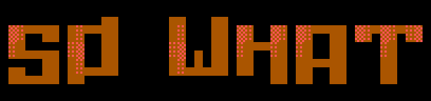

# so-what (`sw`)



**Every commit and pull request opens with its impact.**

A reviewer decides fast when the first lines say what the change means.
so-what teaches your coding agent to write those lines.

Your agent opens each commit message and pull request with three answers:

- **Impact:** who is affected, and what is different for them.
- **Risk:** the worst case, and the checks that ran.
- **Decision:** what the reviewer must choose.

Every answer comes from the real diff. A script reads the diff and sets a
risk floor from the changed paths. A lint step checks the text. At medium
and high risk, an impact map shows cause and effect at a glance.

The reviewer reads the first lines and knows enough to approve, push back,
or escalate.

## Install

The skill needs `git`, Node.js 18 or later, and the `gh` CLI for pull requests.
Its scripts run on macOS, Linux, and Windows.
Pick your agent.

<details>
<summary><strong>Claude Code</strong></summary>

```text
/plugin marketplace add s-gryt/so-what
/plugin install sw@so-what
```

Or copy the files into your project:

```bash
npx github:s-gryt/so-what -a claude
```

Commands: `/sw:commit`, `/sw:pr`, `/sw:pr <number>`.

</details>

<details>
<summary><strong>Codex</strong></summary>

```bash
npx github:s-gryt/so-what -g -a codex
```

Skills: `$sw-commit`, `$sw-pr`.

</details>

<details>
<summary><strong>GitHub Copilot</strong></summary>

```bash
npx github:s-gryt/so-what -a copilot
```

Prompt files: `/sw-commit`, `/sw-pr`. They run in IDEs that support Copilot
prompt files, such as VS Code. Other Copilot clients use the skill alone.

</details>

<details>
<summary><strong>Gemini CLI</strong></summary>

```bash
gemini skills install https://github.com/s-gryt/so-what.git --path skills/so-what
```

Re-run the command to update.

</details>

<details>
<summary><strong>Antigravity</strong></summary>

```bash
npx github:s-gryt/so-what -a antigravity
```

Skills: `/sw-commit`, `/sw-pr`.

</details>

<details>
<summary><strong>Any other agent</strong></summary>

```bash
npx skills@latest add s-gryt/so-what -a <agent>  # cursor, opencode, windsurf, amp; omit -a to choose
```

Or copy `skills/so-what/` into the skills directory of your agent.

</details>

<details>
<summary><strong>Installer options and paths</strong></summary>

```bash
npx github:s-gryt/so-what --agent all          # every supported agent, this project
npx github:s-gryt/so-what -g -a claude,codex   # your user account
npx github:s-gryt/so-what list                 # what is installed where
```

`--force` overwrites existing installs. `--dry-run` prints each skill
directory and command file it would write, and writes nothing.

| Agent          | Skill (project)   | Skill (global)             | Commands                                                               |
| -------------- | ----------------- | -------------------------- | ---------------------------------------------------------------------- |
| Claude Code    | `.claude/skills/` | `~/.claude/skills/`        | `/sw:commit`, `/sw:pr` (`.claude/commands/sw/`)                        |
| Codex          | `.agents/skills/` | `~/.agents/skills/`        | `$sw-commit`, `$sw-pr` (skills next to `so-what`)                      |
| GitHub Copilot | `.github/skills/` | `~/.copilot/skills/`       | `/sw-commit`, `/sw-pr` prompt files (project only, `.github/prompts/`) |
| Antigravity    | `.agents/skills/` | `~/.gemini/config/skills/` | `/sw-commit`, `/sw-pr` (skills next to `so-what`)                      |

Codex and Antigravity share `.agents/skills/` in a project. The installer
writes it once.

</details>

## Use

Ask your agent for a commit or a pull request, or run the command for your
agent from the list above.

See the [worked example](skills/so-what/references/example.md): one change
from diff to commit, pull request, and plan.

<details>
<summary><strong>How it works</strong></summary>

```text
  staged changes (commit) or branch against main (PR)
                                  |
                                  v
  +------------------------------------------------------------------+
  | 1. FACTS    facts.mjs reads the diff and reports:                |
  |             - areas touched: ci, data, interface, ...            |
  |             - protected invariants the change touches            |
  |             - risk floor, set from the changed paths             |
  |               (the author may rate risk higher)                  |
  +------------------------------------------------------------------+
                                  |
                                  v
  +------------------------------------------------------------------+
  | 2. WRITE    the agent drafts the text from the facts:            |
  |             - Impact: who is affected, what is different         |
  |             - Worst case and Decision (medium, high risk)        |
  |             - impact map                                         |
  |             - Rollback (high risk)                               |
  |             - Why, from you; marked (inferred) otherwise         |
  |             - Verification: only the checks that ran             |
  +------------------------------------------------------------------+
                                  |
                                  v
  +------------------------------------------------------------------+
  | 3. CHECK    the agent reads the headline view only and answers   |
  |             three questions: what changed for whom, the worst    |
  |             case, what to decide. An answer that needs more      |
  |             text means rewrite.                                  |
  +------------------------------------------------------------------+
                                  |
                                  v
  +------------------------------------------------------------------+
  | 4. LINT     lint.mjs checks the text and the agent fixes         |
  |             every finding: edit-verb openers, file names,        |
  |             forced negatives, missing fields, bad maps           |
  +------------------------------------------------------------------+
                                  |
                                  v
  +------------------------------------------------------------------+
  | 5. SHIP     commit:       git commit -F <file>                   |
  |             new PR:       gh pr create --body-file <file>        |
  |             existing PR:  upsert-pr.mjs replaces the marked      |
  |                           block and keeps hand-written notes     |
  +------------------------------------------------------------------+
```

The headline view is the part a reviewer reads first:

```text
  commit                              pull request
  +-------------------------------+   +--------------------------------+
  | subject  (the outcome)        |   | title                          |
  | Impact:  first sentence       |   | ## Impact   first sentence     |
  | Risk:    worst case           |   | Worst case: ...                |
  | Needs:   what to decide       |   | Decision:   ...                |
  | [ASCII impact map]            |   | ## Impact map  (ASCII)         |
  +-------------------------------+   | > Why, risk, verification      |
                                      |   (folded)                     |
                                      +--------------------------------+
```

One worked example shows every stage for one change. The test suite lints
it: [facts, commit, pull request, plan, and impact maps](skills/so-what/references/example.md).
Format rules:

- [Commit](skills/so-what/references/commit.md)
- [Pull request block](skills/so-what/references/pull-request.md)
- [Impact maps, ASCII and mermaid](skills/so-what/references/impact-map.md)
- [Plan, written before the code exists](skills/so-what/references/plan.md)
- [Ten graded cases, with traps](skills/so-what/evals/cases.md)
- [Eval method and results](skills/so-what/evals/README.md)

</details>

<details>
<summary><strong>Customize</strong></summary>

**Risk map.** `skills/so-what/scripts/areas.tsv` maps paths to an area and a
risk floor. The first match wins, and the last row catches everything else.
Areas: agents, ci, data, infra, tests, docs, security, interface, flags, deps,
source. Override it per repo with `.so-what/areas.tsv` at the repo root, or
with `SO_WHAT_AREAS=<file>`. Patterns use JavaScript regular expression
syntax. POSIX bracket classes such as `[[:alpha:]]` also work.

**Invariants.** Name the rules your repo protects in
`.so-what/invariants.tsv` (or `SO_WHAT_INVARIANTS=<file>`). Each row holds
`path-regex`, `invariant`, and `owner`, separated by tabs. A change to a
matching path lists the invariant and its owner. It also raises the floor to
medium, and lint then requires the invariant's name in Risk. See
[`invariants.example.tsv`](skills/so-what/references/invariants.example.tsv).

**Plan mode.** Before a PR has code, the agent can write a short plan block
with `upsert-pr.mjs <n> <block> --kind plan --risk <level>`. No diff exists
yet, so `<level>` is the expected risk from the block. The block holds
`## Plan`, the expected risk, and the verification plan. The later recap replaces it and
adds `## Plan vs actual`. `upsert-pr.mjs <n> --show` prints the current block.

</details>

<details>
<summary><strong>Develop</strong></summary>

```bash
node skills/so-what/scripts/test.mjs    # lint, upsert, and facts self-test
node bin/cli.mjs --dir /tmp/demo --agent all --dry-run
```

`skills/so-what/evals/` holds the fixtures, scripts, and results of the
model-graded eval.

</details>
