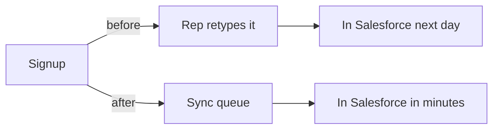

# Worked example

One change, shown at every stage. Every other document in this skill links
here. Edit the scenario in this file only. `scripts/test.mjs` lints each
block below, so the example always passes its own rules.

The change: each new customer goes to Salesforce, the sales team's customer
database, right after signup. Three files change: a new sync module, the
signup handler, and tests.

## Before and after

```diff
 export async function signUp(req, res) {
   const customer = await createCustomer(req.body);
+  await syncQueue.add('salesforce', customer.id);
   return res.status(201).json(customer);
 }
```

Before: sales reps retype each new customer into Salesforce the next day.
After: signup queues the record. The sync module writes it to Salesforce.

## What it enables

- Sales reps call new customers the same day.
- Reps stop retyping records by hand.

## Facts

`node scripts/facts.mjs --staged` reads the diff and sets the risk floor
from the changed paths.

```text
scope: staged changes on main
files: 3  +63 -0
risk: medium (driven by source)
areas:
  source   medium   2 files  +39 -0
  tests    low      1 files  +24 -0
changes:
  A  source   medium src/integrations/salesforce.ts  +38 -0
  M  source   medium src/web/signup.ts  +1 -0
  A  tests    low    tests/salesforce.test.ts  +24 -0
```

The floor is medium. The author rates the change high: a revert leaves the
written records in Salesforce.

## Commit message

Shape and rules: [commit](commit.md).

```text
feat(crm): put each new customer in Salesforce minutes after signup

Impact: Sales reps see each new customer in Salesforce minutes after
signup. Reps stop retyping records and call new customers the same day.
Needs: Approve writing customer records to the production Salesforce
account.
Why: Sales asked for same-day follow-up on every new customer.
Risk: high - worst case, a wrong field mapping writes bad data to every
new Salesforce record. A revert leaves those records in place. Checked:
a test signup reached the Salesforce sandbox in 40 seconds with correct
fields. Not verified: production field rules; owner: sales ops lead,
before merge.
Rollback: revert + delete the Salesforce records the sync created

    before: [Signup] --> [rep retypes it] --> (in Salesforce next day)
    after:  [Signup] --> [sync queue] ------> (in Salesforce in minutes)
```

## Pull request block

Shape and rules: [pull request](pull-request.md).

````markdown
<!-- so-what:start -->
## Impact

Sales reps retyped every new customer into Salesforce, so follow-up calls
waited a day. Each new customer now reaches Salesforce minutes after signup.

Worst case: a wrong field mapping writes bad data to every new Salesforce record.
Decision: approve writing customer records to the production Salesforce account.

## Impact map

```text
before: [Signup] --> [rep retypes it] --> (in Salesforce next day)
after:  [Signup] --> [sync queue] ------> (in Salesforce in minutes)
```

<details>
<summary>Why, risk, verification</summary>

## Why

Sales asked for same-day follow-up on every new customer.

## Risk: high

| Area | Risk | What changes in behavior |
| ---- | ---- | ------------------------ |
| Salesforce data | high | Every new customer creates a Salesforce record |

The floor is medium. A revert leaves the written records in Salesforce, so
the risk is high.

Rollback: revert + delete the Salesforce records the sync created

## Verification

- Signed up a test customer: the record reached the Salesforce sandbox in 40 seconds with correct fields.
- Not verified: production field rules. owner: sales ops lead, before merge.

</details>
<!-- so-what:end -->
````

## Mermaid option

ASCII is the default map. A pull request can draw the same map in mermaid,
which GitHub renders on the PR page. To use it, replace the `text` fence
under `## Impact map` with this fence. Rules: [impact map](impact-map.md).




## Plan block

Written before the code exists. Shape and rules: [plan](plan.md).

````markdown
<!-- so-what:start -->
## Plan

Sales reps will see each new customer in Salesforce minutes after signup.
Reps stop retyping records and call new customers the same day.

## Risk: high

A wrong field mapping could write bad data to every new Salesforce record.
A revert leaves those records in place.

## Verification plan

- Sign up a test customer and check that the record reaches the Salesforce sandbox within minutes.
- Ask the sales ops lead to confirm the production field rules.
<!-- so-what:end -->
````

## Counter-example

The same change, written as a diff narration:

```text
feat: add salesforce sync

Impact: Added salesforce.ts and updated the signup handler.
```

The reader learns which files moved. Who gains, what could break, and what
to decide stay hidden. `lint.mjs` rejects it: edit-verb opener, file name,
and no `Needs:`, `Why:`, `Risk:`, `Rollback:`, or map.
