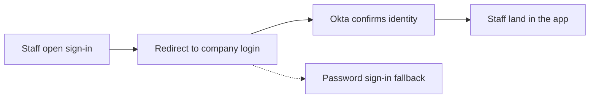

# Pull request recap block

The title follows the commit subject rules. The body is this block plus any
footer the harness requires. `upsert-pr.sh` swaps only the block.

The reader sees `Impact` and `Impact map`; everything else folds into one
`<details>`.

## Block shape

````markdown
<!-- so-what:start -->
## Impact

<Who is affected and what is now different, 1-2 sentences, 20-70 words.
The first sentence (30 words max) names the problem solved or the change
in behavior, in plain words. No file names, no edit-verb openers.>

Worst case: <what could go wrong, 20 words max>
Decision: <what the reviewer must decide before merge, 25 words max>

## Impact map

```mermaid
flowchart LR
    <short plain-word nodes joined by -->
```

<details>
<summary>Why, risk, verification</summary>

## Why

<The problem, request, or constraint behind the change.>

## Risk: <low|medium|high>

| Area | Risk | What changes in behavior |
| ---- | ---- | ------------------------ |
| <area, plain words> | <level> | <consequence, not edit> |

<What could break, for whom, and what would reveal it.>

Rollback: <revert | revert + <extra step> | irreversible: <what is lost>>

## Changes

- <one bullet per logical change, not per file>

## Verification

- <check that ran, and its result>
- Not verified: <what did not run>. owner: <who runs it before merge>

</details>
<!-- so-what:end -->
````

## Rules

- Order: `Impact`, `Impact map` (both visible), then inside `<details>`
  with summary `Why, risk, verification`: `Why`, `Risk: <level>`,
  optional `Plan vs actual`, `Changes`, `Before / after`, then
  `Verification`. Keep a blank line after `</summary>` and before
  `</details>`.
- `Worst case:` sits directly before `Decision:` and is required at
  medium and high risk. `Decision:` is required there too, and never
  starts with "none" at high risk. Neither counts toward Impact's words.
- Labels may be bold (`**Decision:**`). A field continues on indented lines
  and ends at the next unindented line.
- The map is required at medium and high risk. Default to a `mermaid`
  fence; see [impact map](impact-map.md).
- Risk is at least the floor from `facts.sh`. The table must have the
  literal header `Area | Risk` and one row per area, in plain words ("CI
  checks"), merging rows only when they share a consequence.
- `Rollback:` in Risk is required at high risk, case-insensitive.
- Name each touched invariant in Risk, with what the change does to it;
  pass each to lint with `--invariant "<name>"`.
- `Verification` lists what ran, with at least one `- ` item. At high risk
  each "not verified" names `owner:`.
- `Before / after` covers interface, schema, command, or config shape
  changes. `Changes` groups by intent and never restates Impact or Risk.
- Omit empty optional sections. Each fact appears once.
- Budget: aim for 120 words, hard limit 200. Headings, label lines, and the
  `Impact` text count; tables, fenced diagrams, and HTML tag lines do not.

## Example

````markdown
<!-- so-what:start -->
## Impact

Enterprise prospects require staff to sign in with their company accounts,
and deals have waited on it; staff can now sign in through their identity
provider, such as Okta. Each tenant turns SSO on when it is ready.

Worst case: a misconfigured identity provider blocks one tenant's sign-in; password sign-in stays available as the fallback.
Decision: approve turning SSO on per tenant, starting with the pilot customers.

## Impact map



<details>
<summary>Why, risk, verification</summary>

## Why

Security reviews at enterprise prospects require company-managed sign-in,
which sales could not offer.

## Risk: high

| Area | Risk | What changes in behavior |
| ---- | ---- | ------------------------ |
| Sign-in | high | SSO tenants sign in through their company account; others keep passwords |

A tenant with a wrong identity provider setting cannot sign in with SSO
until an admin corrects it; the sign-in page shows the error.

Rollback: revert + SSO tenants return to password sign-in

## Verification

- Signed in through an Okta test tenant: staff reached the right workspace.
- Switched SSO off for that tenant: password sign-in worked again.
- Not verified: Azure AD. owner: platform lead, during the pilot.

</details>
<!-- so-what:end -->
````
